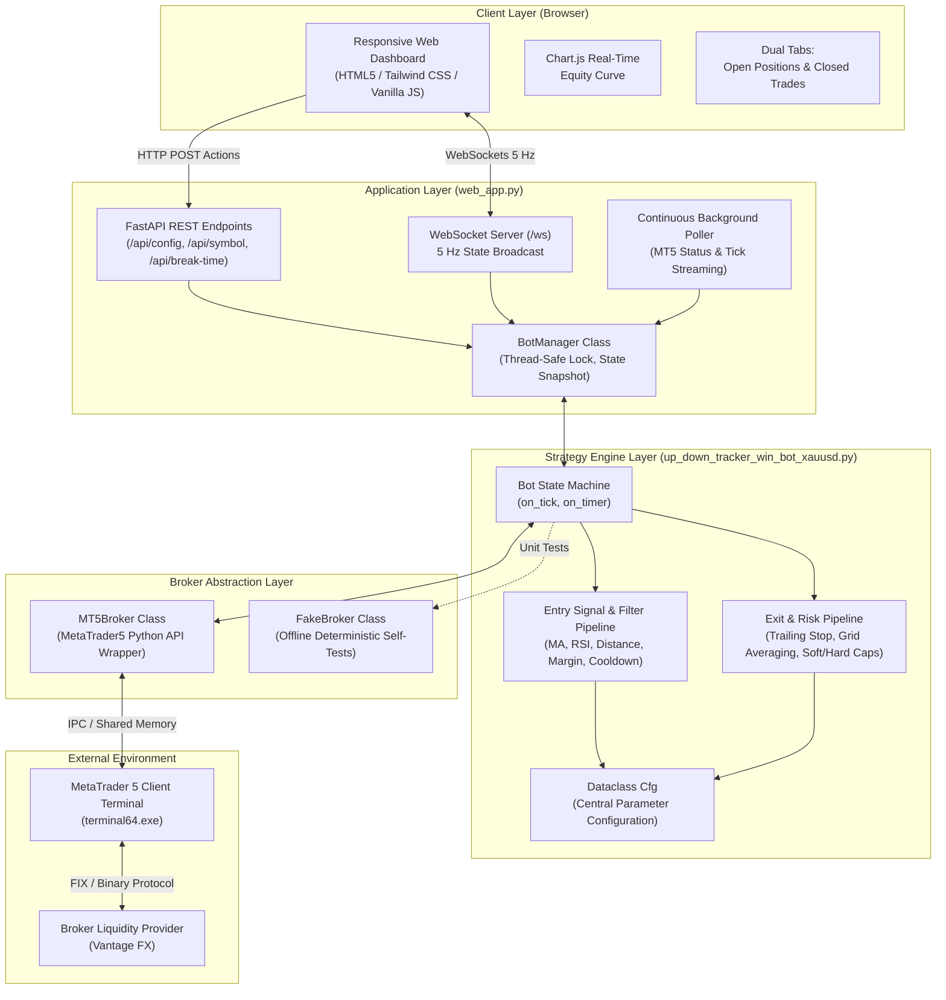
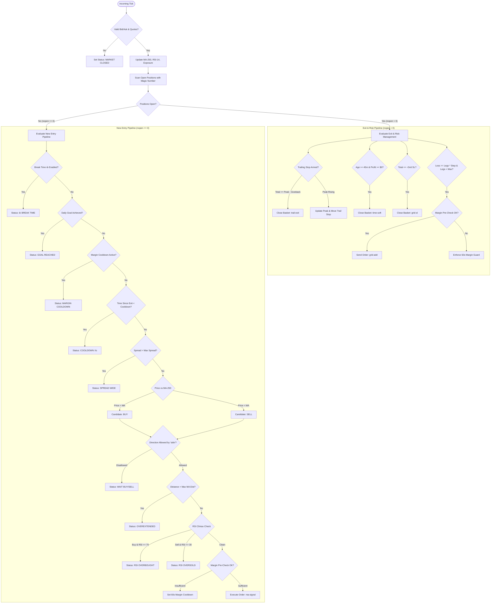

# Vantage Algo — System Architecture & Comprehensive User Guide

> **Version**: 2.5.0 Multi-Asset Production  
> **Target Broker**: Vantage FX / Any MetaTrader 5 Broker  
> **Primary Symbol**: Gold (`XAUUSD`) & Forex / Indices / Commodities  
> **Platform**: Python 3.11 (64-bit) + MetaTrader 5 + FastAPI / WebSockets

---

## 1. System Architecture

### Architectural Principles
1. **Strict Decoupling**: The strategy engine (`Bot`) knows nothing about HTML or WebSockets; it only interfaces with a Broker interface (`MT5Broker` or `FakeBroker`).
2. **Zero-Spam Execution**: All trading actions pass through a local pre-check filter (margin, spread, distance, RSI, cooldown) before `order_send` is invoked.
3. **Dual-Threaded Safety**: The FastAPI web server and WebSocket stream run on the main thread, while the bot execution loop runs in a dedicated background worker thread synchronized via `threading.Lock`.

---

## 2. Order Execution & Strategy Lifecycle

The bot runs on every incoming market tick (`on_tick()`), transitioning through a strict deterministic state sequence:

---

## 3. Mathematical Specifications & Decision Rules

### 3.1 Moving Average Trend Baseline
$$\text{SMA}(P, N) = \frac{1}{N} \sum_{i=0}^{N-1} \text{Close}_{i}$$
* **Default Period**: $N = 250$ bars on timeframe **M1** (representing a rolling ~4-hour trend anchor).
* **Signal**:
  $$\text{Signal} = \begin{cases} \text{BUY}, & \text{Bid} > \text{SMA} \\ \text{SELL}, & \text{Bid} < \text{SMA} \end{cases}$$

### 3.2 Overextension Guard (`max_ma_dist`)
Prevents chasing parabolic breakouts and buying at the peak of a pump.
$$\Delta_{\text{MA}} = |\text{Bid} - \text{SMA}|$$
$$\text{Condition: If } \text{max\_ma\_dist} > 0 \text{ and } \Delta_{\text{MA}} > \text{max\_ma\_dist} \implies \textbf{REJECT ENTRY}$$
* **XAUUSD Calibration**:
  * `0.0`: Filter OFF (instant entry).
  * `5.00 – 8.00`: Recommended for Gold (permits entries in healthy trends, blocks climactic extensions).
  * `1.00 – 2.00`: Ultra-conservative (requires price to touch the MA).

### 3.3 RSI Climax Guard (`rsi_filter`)
Calculates the standard 14-period Relative Strength Index on closed bars:
$$RS = \frac{\text{Average Gain}_{14}}{\text{Average Loss}_{14}}, \quad RSI = 100 - \left(\frac{100}{1 + RS}\right)$$
* **BUY Blocked**: If $RSI \ge \text{rsi\_ob}$ (default: $70.0$).
* **SELL Blocked**: If $RSI \le \text{rsi\_os}$ (default: $30.0$).

### 3.4 Direction Bias Filter (`side`)
Restricts the bot's trade universe to align with higher-timeframe market structure:
* **`both`**: Takes BUYs when price > MA, SELLs when price < MA.
* **`buy`**: Only takes BUY signals. Completely ignores all SELL signals. (Crucial during bull markets).
* **`sell`**: Only takes SELL signals. Completely ignores all BUY signals.

### 3.5 Margin Pre-Check & Anti-Flood Cooldown
Before sending any deal request to MT5:
1. **Order Margin Calculation**:
   $$\text{Margin}_{\text{needed}} = \text{order\_calc\_margin}(\text{type}, \text{symbol}, \text{lots}, \text{price})$$
2. **Buffer Verification**:
   $$\text{FreeMargin} \ge \text{Margin}_{\text{needed}} \times \left(1 + \frac{\text{margin\_buffer\_pct}}{100}\right) \quad \text{AND} \quad \text{FreeMargin} \ge \text{min\_free\_margin}$$
3. **Margin Level Health**:
   $$\text{MarginLevel} = \frac{\text{Equity}}{\text{Margin}} \times 100\% \ge \text{min\_margin\_level} \quad (\text{default: } 200\%)$$
4. **Anti-Flood Throttling**:
   If an order is rejected or margin is insufficient, `margin_cooldown_until` is set to $T_{\text{current}} + 60\text{ seconds}$. The engine is completely silenced from sending orders during this interval.

### 3.6 Break Time ☕ ("Graceful Pause")
* **Active Basket**: Open positions continue to trail, average (if grid enabled), and exit safely.
* **Flat Account**: The moment $\text{nopen} = 0$, all new entries are locked out until the user unchecks Break Time.

### 3.7 Profit-Peak Trailing Stop
Tracks cumulative floating basket P&L ($V_{\text{basket}}$):
1. **Arming**: Trailing stop activates once $V_{\text{basket}} \ge \text{trail\_arm}$ (default: $+\$1.00$ or $+\$2.00$).
2. **Peak Tracking**: $V_{\text{peak}} = \max(V_{\text{peak}}, V_{\text{basket}})$.
3. **Giveback Calculation**:
   $$\text{Giveback} = \max(V_{\text{peak}} \times \text{trail\_give\_frac}, \text{trail\_min\_give})$$
   $$\text{StopLevel} = \max(V_{\text{peak}} - \text{Giveback}, \text{trail\_min\_lock})$$
4. **Exit Trigger**: When $V_{\text{basket}} \le \text{StopLevel}$, the basket is closed immediately at market.

### 3.8 Grid Loss Averaging
* If price moves against an initial leg, additional legs in the same direction are added at fixed loss steps:
  $$\text{Trigger Loss} = -(\text{nopen} \times \text{grid\_step\_loss})$$
* **Leg Cap**: Never exceeds `grid_max_legs` (recommended: $2$ or $3$).
* **Emergency SL**: If total loss $\le -\text{grid\_sl}$, all legs are liquidated immediately.

---

## 4. Complete Configuration Parameter Reference

| Parameter | CLI Flag | Default | Units | Description |
| :--- | :--- | :---: | :---: | :--- |
| `symbol` | `--symbol` | `XAUUSD` | String | Financial instrument ticker symbol |
| `lots` | `--lots` | `0.01` | Lots | Base position volume per trade leg |
| `side` | `--side` | `both` | Enum | Trading direction bias: `both`, `buy`, `sell` |
| `daily_goal` | `--daily-goal` | `20.00` | USD (\$) | Target daily profit; trading halts when reached |
| `ma_period` | `--ma-period` | `250` | Bars | Trend Moving Average period |
| `tf` | `--tf` | `M1` | Timeframe | Bar timeframe for Moving Average (`M1`, `M5`, `M15`) |
| `max_ma_dist` | `--max-ma-dist` | `0.0` | Price (\$) | Max allowable distance from MA (0 = Disabled) |
| `rsi_filter` | `--rsi-filter` | `False` | Boolean | Enable RSI overbought/oversold entry filter |
| `rsi_period` | `--rsi-period` | `14` | Bars | RSI calculation period |
| `rsi_ob` | `--rsi-ob` | `70.0` | Level | RSI overbought threshold (blocks BUYs) |
| `rsi_os` | `--rsi-os` | `30.0` | Level | RSI oversold threshold (blocks SELLs) |
| `min_entry_gap_sec`| `--min-entry-gap-sec` | `15` | Seconds | Mandatory cooldown between consecutive trade exits |
| `min_free_margin` | `--min-free-margin` | `10.00` | USD (\$) | Min account free margin required to attempt order |
| `min_margin_level`| `--min-margin-level` | `200.0`| Percent | Min margin level % required to allow new order |
| `margin_buffer_pct`| `--margin-buffer-pct`| `20.0` | Percent | Safety buffer above MT5 margin requirement |
| `break_time` | `--break-time` | `False` | Boolean | Graceful pause: finish open trades, block new entries |
| `grid_sessions` | `--grid-sessions` | `True` | Boolean | Enable multi-leg loss grid averaging |
| `grid_step_loss` | `--grid-step-loss` | `10.00` | USD (\$) | Drawdown per leg required before adding next leg |
| `grid_max_legs` | `--grid-max-legs` | `5` | Integer | Hard ceiling on total simultaneous legs (Recommend: 2) |
| `grid_sl` | `--grid-sl` | `200.00` | USD (\$) | Emergency basket catastrophe stop loss |
| `trail_on` | `--trail-on` | `True` | Boolean | Enable dynamic profit-peak trailing stop |
| `trail_arm` | `--trail-arm` | `1.00` | USD (\$) | Profit threshold where trailing stop activates |
| `trail_give_frac` | `--trail-give-frac` | `0.20` | Fraction | Trailing giveback fraction (0.20 = 20%) |
| `trail_min_lock` | `--trail-min-lock` | `0.30` | USD (\$) | Absolute floor profit locked when trailing arms |
| `soft_cap_min` | `--soft-cap-min` | `45` | Minutes | Closes stale trades after N minutes if profit $\ge \$0$ |
| `magic` | `--magic` | `123790`| Integer | Unique MT5 identifier for primary bot trades |

---

## 5. Web Dashboard User Guide

### 5.1 Launching the Interface
1. Ensure MetaTrader 5 is running (or configured in `.env`).
2. Double-click [`run_ui.bat`](file:///c:/Users/dayam/Documents/vantage-algo/run_ui.bat).
3. The dashboard opens at `http://localhost:8000`.

### 5.2 Header Controls
* **Theme Toggle (`🌙` / `☀️`)**: Switches between Financial Light mode (default) and Dark mode.
* **Allow Real Checkbox**: Safety interlock. Must be checked before pressing Start on real/live accounts.
* **Break Time ☕**: One-click graceful pause button. Highlights in amber when active.
* **Start / Stop Bot**: Starts or halts the execution loop.
* **Emergency Close All (`⚠️`)**: Immediately market-closes all bot positions.
* **Bot Settings (`⚙️`)**: Opens live parameter modal. Changes take effect on running bots immediately.

### 5.3 Positions & Trades Panel (Dual Tabs)
* **`Open` Tab**: Shows currently running positions with real-time floating P&L, lot size, entry price, and **`B`** (Bot) vs **`U`** (User manual) badges.
* **`Closed` Tab**: Displays the session's audit log of closed trades with entry price, exit price, timestamp, and net realized P&L.

### 5.4 Real-Time Entry Telemetry & MA Radar
To eliminate any ambiguity on why the bot is waiting, the dashboard computes and streams live entry readiness telemetry 5 times per second:
* **Current MA**: Continuous SMA of closing prices on the configured timeframe (default: M1 250). Evaluated even when the bot is stopped.
* **MA Distance**: Current price stretch from the MA:
  $$\text{Dist}_{\text{MA}} = |P_{\text{bid}} - \text{MA}|$$
* **Max Allowed Distance**: The active `max_ma_dist` threshold setting (e.g., \$2.50 or \$1.00). If disabled, displays `Unlimited`.
* **Waiting For Price / Target Entry Condition**:
  * If $\text{Dist}_{\text{MA}} > \text{Max MA Dist}$ (Overextended): Calculates the exact price price must reach and how much it needs to pull back (e.g. `BUY: <= 2732.50 (Drop -$2.15)` or `SELL: >= 2727.50 (Rise +$2.15)`).
  * If Price is on the wrong side of the MA: Displays the cross condition (e.g. `> 2730.00 (Rise +$1.80)`).
  * If Price is within the allowable window: Displays `In Zone (Ready)` in vibrant emerald green.
* **Radar Banner**: Centered between the metric cards and chart, featuring an animated radar status beacon and status headlines (e.g., `Price in Entry Zone — Engine armed`, `Overextended — Waiting for pullback`, `Active Position Open`, or `☕ Break Time Active`).

---

## 6. Safe Operational Playbook (Capital Preservation Rules)

1. **Small Account Rule (Equity < \$200)**:
   * Set **`Grid Max Legs = 2`** (never allow 5 legs on small accounts).
   * Set **`Emergency Grid SL = $15.00`**.
2. **Trend Alignment Rule**:
   * If Gold is in a strong daily uptrend, set **`Direction Bias = Buy Only`**.
   * Never trade `Both` during strong macroeconomic news releases.
3. **Nighttime & Inactivity**:
   * Check **`☕ Break Time`** 30 minutes before leaving your desk. Allow active trades to finish and close in profit, and let the bot rest.

