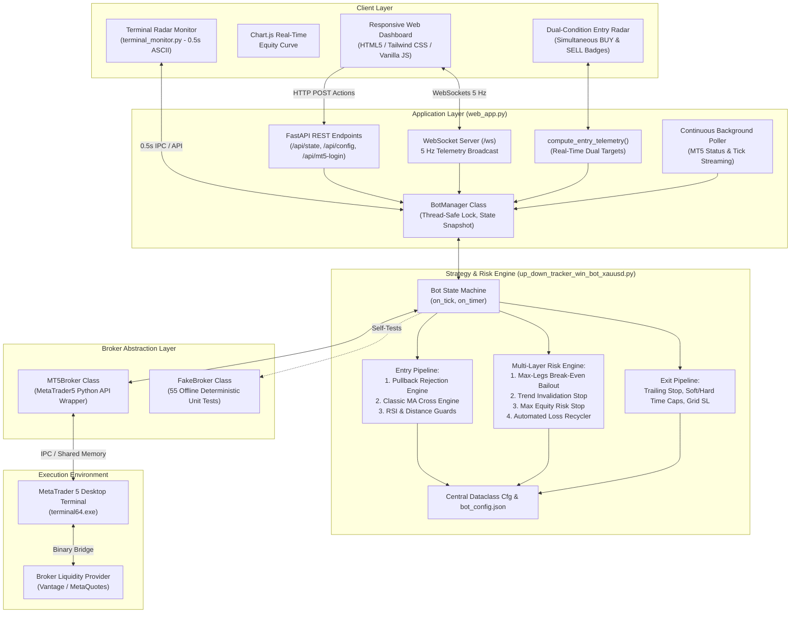
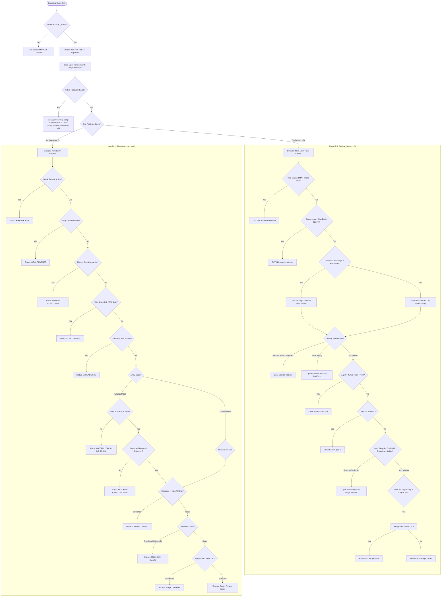

# Vantage Algo — System Architecture & Comprehensive User Guide

> **Version**: 3.0.0 Multi-Asset Production & Institutional Risk Engine  
> **Target Broker**: MetaTrader 5 (Vantage FX / MetaQuotes / Any MT5 Broker)  
> **Primary Symbol**: Gold (`XAUUSD`) & Forex Majors, Indices, Commodities, Crypto  
> **Platform**: Python 3.11 (64-bit) + MetaTrader 5 + FastAPI / WebSockets + CLI Terminal Radar

---

## 1. System Architecture



### Architectural Principles
1. **Decoupled Modularity**: The core strategy engine (`Bot`) is entirely independent of HTTP or WebSocket dependencies; it interfaces strictly with the broker abstraction layer (`MT5Broker` or `FakeBroker`).
2. **Multi-Layer Defensive Risk Shield**: Every trading tick is filtered through six independent risk barriers (Margin Pre-Check, Anti-Flood Cooldown, Spread Guard, Max-Legs Bailout, Trend Invalidation Cut, and Max Equity Risk Stop).
3. **Dual-Threaded Concurrency**: The FastAPI web server and WebSocket broadcaster operate on the main async event loop, while the bot execution loop runs in a dedicated background worker thread synchronized via `threading.Lock`.
4. **Dual-Channel Monitoring**: Operators can monitor executions via the browser UI (`http://localhost:8000`) or via the zero-dependency CLI radar (`terminal_monitor.py`) at 0.5s refresh rates.

---

## 2. Order Execution & Strategy Lifecycle

The bot evaluates every incoming market quote (`on_tick()`), transitioning through a deterministic state machine:



---

## 3. Mathematical Specifications & Decision Rules

### 3.1 Moving Average Trend Baseline
$$\text{SMA}(P, N) = \frac{1}{N} \sum_{i=0}^{N-1} \text{Close}_{i}$$
* **Default Period**: $N = 250$ bars on timeframe **M1** (representing a ~4-hour trend anchor).
* **Macro Bias**:
  $$\text{Macro Direction} = \begin{cases} +1 \text{ (Bullish)}, & \text{Bid} \ge \text{SMA} \\ -1 \text{ (Bearish)}, & \text{Bid} < \text{SMA} \end{cases}$$

### 3.2 Pullback Rejection Engine (`entry_mode: "pullback"`)
Replaces direct knife-catching entries with verified momentum bounces:
1. **Pullback Zone Verification**:
   $$\text{Dist} = |\text{Bid} - \text{SMA}| \le \text{pullback\_zone} \quad (\text{default: } \$3.00)$$
2. **Dynamic Crest & Trough Tracking**:
   * For **BUY (Bullish Macro)**: Tracks lowest low in the dip:
     $$\text{Trough} = \min(\text{Trough}, \text{Bid})$$
     $$\text{Bounce Rise} = \text{Ask} - \text{Trough}$$
     $$\text{Trigger Condition}: \text{Bounce Rise} \ge \text{pullback\_rejection\_dist} \quad (\text{default: } +\$0.60)$$
   * For **SELL (Bearish Macro)**: Tracks highest high in the rally:
     $$\text{Crest} = \max(\text{Crest}, \text{Ask})$$
     $$\text{Rejection Drop} = \text{Crest} - \text{Bid}$$
     $$\text{Trigger Condition}: \text{Rejection Drop} \ge \text{pullback\_rejection\_dist} \quad (\text{default: } \$0.60)$$

### 3.3 Multi-Layer Catastrophe Protections
* **Max-Legs Break-Even Bailout (`bailout_on_max_legs: True`)**:
  When $N_{\text{open}} \ge \text{grid\_max\_legs}$, the basket switches from profit accumulation to capital preservation:
  $$\text{Basket Target} = \text{bailout\_target} \quad (\text{default: } +\$0.05)$$
  The basket escapes at break-even on the first minor market retracement.
* **Trend Invalidation Stop (`trend_stop_dist = 6.00`)**:
  If a basket direction is violently invalidated by price blowing through the MA:
  $$\text{BUY Basket Cut If: } \text{Bid} < \text{SMA} - \text{trend\_stop\_dist}$$
  $$\text{SELL Basket Cut If: } \text{Bid} > \text{SMA} + \text{trend\_stop\_dist}$$
* **Max Equity Risk Stop (`max_equity_risk_pct = 20.0`)**:
  Hard portfolio circuit breaker:
  $$\text{Cut Basket If: } |V_{\text{basket}}| \ge \text{Equity} \times \left(\frac{\text{max\_equity\_risk\_pct}}{100}\right)$$

### 3.4 Automated Loss Recycler (`loss_recycler: True`)
Actively repairs underwater grids by scalping market micro-swings:
1. When grid drawdown exceeds threshold and a micro-bounce occurs:
   $$\text{Open Scalp with Magic } 789998 \text{ in Counter/Rebound Direction}$$
2. When the recovery scalp hits profit:
   $$V_{\text{rec}} \ge \text{recycle\_tp} \quad (\text{default: } +\$1.50)$$
3. The engine harvests the profit and **automatically liquidates the worst underwater grid leg**, shrinking the total grid exposure back down towards safe levels without taking net losses.

### 3.5 Real-Time Dual Condition Entry Radar
When `Direction Bias = BOTH`, the telemetry engine evaluates conditions for both directions simultaneously:
* **BUY Condition**:
  * If $\text{Bid} > \text{SMA} + \text{pullback\_zone}$: Target is $\le \text{SMA} + \text{pullback\_zone}$ with required dip calculated:
    $$\Delta_{\text{dip}} = \text{Bid} - (\text{SMA} + \text{pullback\_zone})$$
  * If in Dip Zone: Reports `Dip Zone (Wait +$0.60 Bounce)`.
  * If below SMA: Reports $> \text{SMA}$ with required rise to bull zone.
* **SELL Condition**:
  * If $\text{Bid} < \text{SMA} - \text{pullback\_zone}$: Target is $\ge \text{SMA} - \text{pullback\_zone}$ with required rally calculated:
    $$\Delta_{\text{rally}} = (\text{SMA} - \text{pullback\_zone}) - \text{Bid}$$
  * If in Rally Zone: Reports `Rally Zone (Wait -$0.60 Rejection)`.
  * If above SMA: Reports $< \text{SMA}$ with required drop to bear zone.

### 3.6 Overextension Guard (`max_ma_dist`)
Prevents buying overextended peaks or selling oversold bottoms:
$$\text{Condition: If } \text{max\_ma\_dist} > 0 \text{ and } |\text{Bid} - \text{SMA}| > \text{max\_ma\_dist} \implies \textbf{BLOCK ENTRY}$$

### 3.7 RSI Climax Guard (`rsi_filter`)
14-period RSI calculated on closed M1 bars:
* **BUY Blocked**: If $RSI \ge \text{rsi\_ob}$ (default: $70.0$).
* **SELL Blocked**: If $RSI \le \text{rsi\_os}$ (default: $30.0$).

### 3.8 Margin Pre-Check & Anti-Flood Cooldown
Before sending any deal request to MT5:
1. **Order Margin Calculation**:
   $$\text{Margin}_{\text{needed}} = \text{order\_calc\_margin}(\text{type}, \text{symbol}, \text{lots}, \text{price})$$
2. **Buffer Verification**:
   $$\text{FreeMargin} \ge \text{Margin}_{\text{needed}} \times 1.20 \quad \text{AND} \quad \text{FreeMargin} \ge \$10.00$$
3. **Anti-Flood Throttling**:
   If an order is rejected or margin is insufficient, `margin_cooldown_until` locks new orders for 60 seconds, preventing broker account lockouts.

### 3.9 Multi-Account Auto-Discovery & Dynamic Account Switcher
* **Zero-Prompt Attachment**: If an MT5 terminal is already running on the host machine, the engine attaches directly to the active session via `mt5.initialize()`. Zero manual credentials or login popups are presented.
* **Auto-Discovery**: Automatically discovers all accounts logged into or authorized on the MT5 terminal (`data_path/logs/*.log`) and combines them with `saved_accounts.json`.
* **Live Synchronization**:
  1. Switching accounts in the MT5 desktop GUI is detected in real time (< 0.5s) and immediately updates the web dashboard.
  2. The interactive Account Switcher dropdown allows 1-click switching directly from the dashboard header without terminal restarts.

### 3.10 Dynamic Global Tooltip Portal & Collision Edge Detection
* **On-Demand Metric Guidance**: Hovering over any indicator's information icon (`ⓘ`) reveals a glassmorphic tooltip detailing its financial meaning, mathematical formula, and real-time strategic function.
* **Global Portal Architecture**: Rather than nesting tooltips inside cards or tables where `overflow: hidden` or stacking contexts can clip or truncate them, tooltips are rendered via a single dynamic portal (`#global-tooltip`) mounted directly to `document.body` at `z-index: 999999`.
* **Dynamic Collision & Edge Detection**:
  - *Vertical Inversion*: Automatically detects viewport top boundaries; if an indicator (e.g. `TREND: BEARISH` in Card 1) is near the top of the screen, the tooltip automatically flips to display underneath with an upward-pointing arrow.
  - *Horizontal Clamping*: Prevents right-edge and left-edge truncation on mobile or desktop viewports by clamping within a $12\text{px}$ screen margin.
  - *Sliding Pointer Arrow*: Pinpoints the exact center of the `ⓘ` icon regardless of horizontal clamping.
* **Universal Coverage**: Deployed across all 5 Primary Metric Cards, Section 2 Entry Radar, Section 3 Analytics & Table Headers (Open & Closed positions), Section 4 Decision Log, and all 29 configuration parameters in the Bot Settings modal.

### 3.11 Dual Timezone Engine (Local IST & MT5 Broker Server Time)
* **Desktop MT5 Behavior**: MetaTrader 5 desktop client natively displays broker server time (EET, typically UTC+2 in winter and UTC+3 in summer) across its charts, Market Watch, and Trade History. It does not provide an option to switch to local time (IST).
* **Dual Time Display**: The dashboard automatically calculates the broker's UTC offset from live ticks and maps all deal timestamps to local **Indian Standard Time (IST, UTC+5:30)**.
* **1:1 MT5 Cross-Referencing**: Beneath each IST timestamp in the Open and Closed Positions tables, the system displays the original MT5 Broker Server Time (`MT5 Server: HH:MM:SS`), allowing traders to cross-reference every trade ticket in the desktop MT5 client without mental math.

### 3.12 Proportional Lot-Size Auto-Scaling & Anti-Rally Cooling-Off Pause
* **Proportional Scaling Multiplier**: Dynamically computes $\text{lot\_mult} = \frac{\text{lots}}{\text{base\_lot}}$. All price-distance dollar thresholds (`grid_step_loss`, `grid_sl`, `trail_arm`, `trail_min_lock`, `grid_tp`, `target_profit`, `bailout_target`, `recycle_tp`, `recycle_sl`, and `stop_loss`) automatically scale proportionally with lot volume. This guarantees that trading $0.10$ lots requires the exact same $\$10.00$ Gold price movement per grid step as $0.01$ lots, preventing premature grid stacking.
* **Post-Loss Anti-Rally Pause**: Whenever a stop-loss is triggered (`grid-sl`, `trend-inval`, `equity-risk-sl`, `stop-loss`), the bot enforces an extended cooling-off pause (`loss_cooldown_sec = 180s` / 3 minutes default). During this window, all initial entries and flips are halted (`PAUSED AFTER LOSS <rem>s`), preventing consecutive stop-outs during runaway momentum rallies.

### 3.13 Trade Excursion Telemetry (MAE & MFE Analytics)
* **Empirical Optimization over Guesswork**: Rather than guessing parameter distances, the engine tracks live mark-to-market excursions on every tick:
  - **MFE (Maximum Favorable Excursion)**: The absolute peak floating profit reached by a position/basket during its open lifetime.
  - **MAE (Maximum Adverse Excursion)**: The deepest floating drawdown suffered by a position/basket during its open lifetime.
* **Full-Stack Persistence**:
  - Tracked tick-by-tick in the core `Bot` class.
  - Recorded in the CSV decision log (`up_down_tracker_decisions_py.csv`).
  - Saved persistently in `trade_excursions.json` so historical trade excursions are retained across restarts.
  - Rendered in real-time in both the Open Positions (`Peak` / `Dip`) and Closed Positions tables with explanatory guidance tooltips.
* **Chronicle & Evolution**: For the full narrative detailing the discovery of these solutions during live demo testing, see [`DEV_JOURNAL.md`](file:///c:/Users/dayam/Documents/vantage-algo/DEV_JOURNAL.md).

---

## 4. Complete Configuration Parameter Reference

| Parameter | Type | Default | Units | Description |
| :--- | :---: | :---: | :---: | :--- |
| `symbol` | String | `XAUUSD` | Ticker | Traded financial instrument |
| `tf` | String | `M1` | Timeframe | Moving average timeframe (`M1`, `M5`, `M15`) |
| `lots` | Float | `0.01` | Lots | Base position volume per trade leg |
| `scale_by_lots` | Boolean | `True` | Boolean | Auto-scale dollar thresholds proportionally with lot size |
| `base_lot` | Float | `0.01` | Lots | Reference lot size for baseline dollar parameters |
| `loss_cooldown_sec` | Integer | `180` | Seconds | Mandatory cooling-off pause after a stop loss before re-entering |
| `side` | String | `both` | Enum | Direction bias: `both`, `buy`, `sell` |
| `entry_mode` | String | `pullback` | Enum | Entry logic: `pullback` (rejection bounce) or `classic` (direct MA) |
| `pullback_zone` | Float | `3.00` | USD (\$) | Max distance from MA defining the dip/rally pullback zone |
| `pullback_rejection_dist`| Float | `0.60` | USD (\$) | Required price bounce from trough/crest before entry |
| `daily_goal` | Float | `100.00` | USD (\$) | Target daily profit; trading halts when reached |
| `basket_target` | Float | `0.10` | USD (\$) | Target profit for non-grid single leg baskets |
| `min_entry_gap_sec` | Integer | `15` | Seconds | Mandatory cooldown between consecutive exits |
| `ma_period` | Integer | `250` | Bars | Trend Moving Average period |
| `max_ma_dist` | Float | `8.00` | USD (\$) | Overextension ceiling (blocks entry if price stretched $> \$8$) |
| `rsi_filter` | Boolean | `True` | Boolean | Enable RSI overbought/oversold entry barrier |
| `rsi_period` | Integer | `14` | Bars | RSI calculation period |
| `rsi_ob` | Float | `70.0` | Level | RSI overbought threshold (blocks BUYs) |
| `rsi_os` | Float | `30.0` | Level | RSI oversold threshold (blocks SELLs) |
| `grid_sessions` | Boolean | `True` | Boolean | Enable multi-leg loss grid averaging |
| `grid_step_loss` | Float | `10.00` | USD (\$) | Drawdown per leg required before adding next leg |
| `grid_max_legs` | Integer | `3` | Integer | Hard ceiling on simultaneous grid legs |
| `grid_tp` | Float | `0.20` | USD (\$) | Take profit for grid sessions when trailing is disabled |
| `grid_sl` | Float | `20.00` | USD (\$) | Hard dollar catastrophe stop loss for basket |
| `bailout_on_max_legs` | Boolean | `True` | Boolean | Lowers profit target to break-even once max legs are reached |
| `bailout_target` | Float | `0.05` | USD (\$) | Break-even bailout exit target profit |
| `trend_stop_dist` | Float | `6.00` | USD (\$) | Distance past MA against position that triggers trend cut |
| `max_equity_risk_pct` | Float | `20.0` | Percent | Max percentage of account equity at risk before emergency cut |
| `loss_recycler` | Boolean | `True` | Boolean | Enable automated recovery scalping to prune underwater legs |
| `recycle_tp` | Float | `1.50` | USD (\$) | Profit target on recovery scalp |
| `recycle_sl` | Float | `1.50` | USD (\$) | Stop loss on recovery scalp |
| `recycle_bounce_dist` | Float | `0.50` | USD (\$) | Required bounce to trigger recovery scalp |
| `recycle_cooldown_sec`| Integer | `60` | Seconds | Cooldown between recovery scalp attempts |
| `trail_on` | Boolean | `True` | Boolean | Enable profit-peak dynamic trailing stop |
| `trail_arm` | Float | `1.00` | USD (\$) | Profit threshold where trailing stop activates |
| `trail_give_frac` | Float | `0.20` | Fraction | Trailing giveback fraction (0.20 = 20%) |
| `trail_min_lock` | Float | `0.30` | USD (\$) | Absolute profit floor locked once trailing arms |
| `soft_cap_min` | Integer | `45` | Minutes | Closes stale trades after N minutes if profit $\ge \$0$ |
| `break_time` | Boolean | `False` | Boolean | Graceful pause: finish open trades, block new entries |
| `magic` | Integer | `123790` | Integer | MT5 magic number for primary grid legs |
| `magic_recovery` | Integer | `789998` | Integer | MT5 magic number for loss recycler scalps |

---

## 5. User Guides & Monitoring Tools

### 5.1 Web Dashboard (`web_app.py`)
1. Launch via double-clicking [`run_ui.bat`](file:///c:/Users/dayam/Documents/vantage-algo/run_ui.bat) or running `python web_app.py`.
2. Connects to `http://localhost:8000`.
3. **Card 1 (Market Slate)**: Expanded 2-column view displaying live Bid/Ask quotes, spread, MA-250, RSI-14, MA Distance, and dual stacked BUY & SELL waiting targets.
4. **Entry Radar Bar**: Centered below metric cards. When direction bias is `BOTH`, presents dual Emerald (BUY) and Rose (SELL) badges detailing active pullback conditions and trigger prices.
5. **Card 5 (Daily Progress)**: Compact single-column goal tracker showing dollar progress and percentage.

### 5.2 Standalone CLI Radar Monitor (`terminal_monitor.py`)
Run in any Windows Terminal or PowerShell window:
```powershell
python terminal_monitor.py
```
* **Auto-refresh**: Every **0.5 seconds**.
* **Visuals**: Full ASCII dashboard with:
  * Live quote metrics and spread
  * Moving Average, RSI-14, and MA Distance
  * Engine operational status (cooldown, waiting pullback, active grid)
  * Open position stack with ticket numbers, volume, entry prices, floating P&L, and `[GRID]` vs `[RECOVERY]` tags
  * Active safety guard checklist status

---

## 6. Safe Operational Playbook (Capital Preservation Rules)

1. **Small Account Rule (Equity < \$200)**:
   * Keep **`grid_max_legs = 2` or `3`**.
   * Keep **`lots = 0.01`**.
   * Keep **`grid_sl = 20.00`**.
   * Keep **`bailout_on_max_legs = True`**.
2. **Trend Alignment Rule**:
   * In sustained multi-hour trends, set **`Direction Bias = Buy Only`** (bullish) or **`Sell Only`** (bearish).
   * Do not leave `Both` active during high-impact news releases (NFP, CPI, FOMC).
3. **Desk Departure & Nighttime**:
   * Enable **`☕ Break Time`** 30 minutes before stepping away. All open positions will close out safely, and the bot will remain safely flat.
